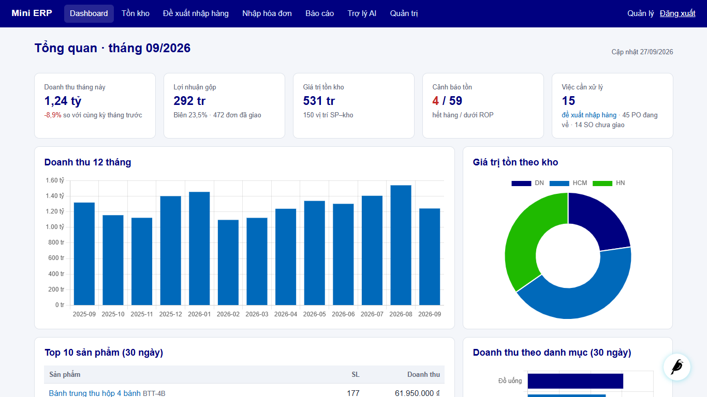
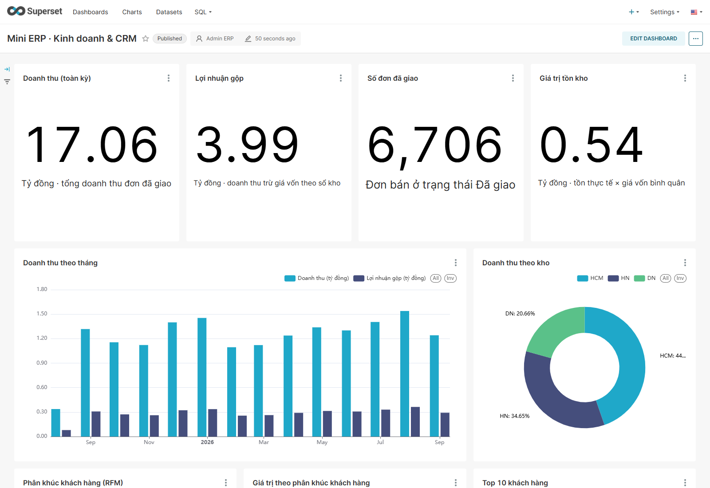
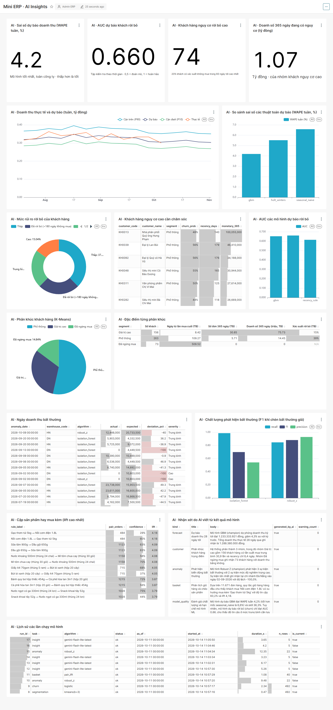

# Mini ERP – Quản lý kho & đơn hàng tích hợp AI (Wagtail CMS)

Hệ thống ERP thu nhỏ cho doanh nghiệp phân phối: danh mục, nhà cung cấp, 3 kho, đơn mua (PO), đơn bán (SO),
tồn kho và sổ kho; kết hợp OpenAI để **đề xuất nhập hàng**, **viết báo cáo định kỳ** và **trả lời câu hỏi về dữ liệu**.

Nguyên tắc: mọi con số do hệ thống tính; AI chỉ diễn giải, khuyến nghị trong biên cho phép, và luôn có phương án
dự phòng (công thức / mẫu) khi không có API key hoặc AI lỗi.

## Tính năng

| Nhóm | Nội dung |
|---|---|
| Quản trị Wagtail | Snippets cho Sản phẩm, Danh mục, NCC, Kho, Khách hàng, PO, SO (lọc, tìm kiếm, xuất CSV/Excel); trang chi tiết chứng từ với nút **Duyệt / Nhận hàng (một phần) / Xác nhận / Giao / Hủy** theo quyền; **Điều chỉnh tồn**, **Chuyển kho**; panel cảnh báo tồn kho trên trang chủ admin |
| Tồn kho | Service layer có khóa dòng, không âm kho, giữ hàng cho SO, giá vốn bình quân, sổ kho bất biến |
| F1 – Đề xuất nhập hàng | Dự báo nhu cầu (mức gần đây + mùa vụ cùng kỳ năm trước), tồn an toàn, ROP theo từng kho → AI xem lại, điều chỉnh (±30%) và giải thích → người dùng duyệt → PO nháp gom theo NCC × kho |
| F2 – Báo cáo AI | KPI kỳ (doanh thu, lợi nhuận gộp, so sánh kỳ trước, top SP, theo kho/danh mục, hàng chậm luân chuyển, PO trễ) → AI viết nhận xét → **trang Wagtail nháp + workflow duyệt** → xuất bản; tự kiểm tra số liệu AI viết |
| F3 – Trợ lý dữ liệu | Chat hỏi đáp dùng function calling trên 6 hàm tra cứu chỉ-đọc (không sinh SQL) |
| F4 – Nhập hóa đơn NCC | Tải ảnh hóa đơn → AI (vision) đọc → hệ thống khớp NCC (mã số thuế / tên) và sản phẩm (SKU / tên), cảnh báo giá lệch, tổng tiền lệch → người dùng sửa, xác nhận → PO nháp |
| Frontend `/app/` | Dashboard KPI + Chart.js, tồn kho có lọc, chi tiết sản phẩm (biểu đồ 52 tuần + dự báo + nút *Phân tích AI*), đề xuất nhập hàng, nhập hóa đơn, báo cáo, trợ lý (HTMX) |
| Phân quyền | 4 nhóm: Quản lý, Thủ kho, Mua hàng, Bán hàng (`setup_roles`) |
| Vận hành | Nhật ký gọi AI (token, thời gian, lỗi), cấu hình AI trong Wagtail Settings, scheduler hằng ngày/tuần, Docker Compose |
| **BI – Apache Superset** | PostgreSQL + Superset chạy bằng Docker; schema `analytics` gồm 13 view chỉ-đọc (dimension / fact / mart, có phân khúc khách hàng RFM); dashboard 13 biểu đồ tạo tự động qua REST API; lệnh đối chiếu số liệu với ORM |
| **AI Analytics + Superset MCP** | App `insights`: 5 bài toán ML (dự báo doanh thu, phân khúc K-Means, dự báo rời bỏ, phát hiện bất thường, giỏ hàng), mỗi bài so sánh nhiều thuật toán với mốc so sánh bằng backtest; kết quả có phiên bản trong PostgreSQL → 7 view `mart_ai_*` → dashboard **AI Insights** 16 biểu đồ; LLM viết nhận xét có kiểm tra số; **`mcp-superset`** cho AI agent duyệt dữ liệu và tạo biểu đồ với tài khoản quyền hạn chế |

## Chạy nhanh

```bash
python -m venv .venv
.venv\Scripts\activate                      # macOS/Linux: source .venv/bin/activate
pip install -r requirements-dev.txt
copy .env.example .env                      # AI_PROVIDER=openai|gemini + key tương ứng (không bắt buộc)

python manage.py setup_demo                 # database + dữ liệu mẫu 2 năm + tài khoản demo (~10-15 phút trên SQLite)
                                            # nhanh hơn: setup_demo --quick (~2-3 phút, 60 ngày, không có mùa vụ)
python manage.py runserver
```

### Bật dashboard phân tích (Apache Superset)

```bash
docker compose -f docker-compose.analytics.yml up -d --build   # PostgreSQL 5433 + Superset 8089
python manage.py migrate
python manage.py copy_sqlite_to_postgres     # chép dữ liệu từ db.sqlite3 (đã setup_demo) sang PostgreSQL
# Không nên chạy seed_data trực tiếp trên PostgreSQL trong Docker (Windows): mỗi truy vấn có độ trễ mạng nên
# 2 năm dữ liệu mất hơn 1 giờ; seed trên SQLite (~14 phút cho 500 khách) rồi chép sang chỉ mất vài phút.
python manage.py create_analytics_views      # schema analytics + role chỉ-đọc
python manage.py provision_superset          # dataset + biểu đồ + dashboard
python manage.py verify_analytics            # đối chiếu số liệu với ORM
```

Dashboard: <http://127.0.0.1:8089/superset/dashboard/mini-erp-crm/> ·
chi tiết trong [docs/SUPERSET.md](docs/SUPERSET.md).

### Phân tích AI và Superset MCP (TH2)

```bash
python manage.py run_ml_pipeline              # huấn luyện + đánh giá 5 bài toán, lưu kết quả (thêm --no-ai nếu không có key)
python manage.py create_analytics_views       # cập nhật view mart_ai_*
python manage.py provision_superset           # thêm dashboard "Mini ERP · AI Insights"

# Superset MCP (mcp-superset trên PyPI, đã có trong requirements-dev.txt)
copy .env.mcp.example .env.mcp                # đặt SUPERSET_PASSWORD cho tài khoản mcp_agent
docker exec -e MCP_USERNAME=mcp_agent -e MCP_PASSWORD=<mật khẩu> erp_superset python /app/create_mcp_user.py
python scripts/mcp_smoke_test.py --write      # kiểm tra kết nối, quyền, tạo/xóa thử 1 biểu đồ
```

Dashboard AI: <http://127.0.0.1:8089/superset/dashboard/mini-erp-ai-insights/>.
Claude Code tự nạp MCP server từ `.mcp.json` khi mở dự án. Mô hình, kết quả đánh giá, cấu hình MCP và bảo mật:
[docs/AI_ANALYTICS.md](docs/AI_ANALYTICS.md).

> **Thành viên mới clone repo:** database (`db.sqlite3`) và file `.env` **không có trong git**, nên sau khi
> `git clone`/`git pull` phải chạy `python manage.py setup_demo` một lần thì mới có dữ liệu và các tài khoản bên dưới.
> Mỗi người tự tạo `.env` từ `.env.example` và dùng API key của mình (không gửi key qua git hay chat).
> `setup_demo` tương đương chạy lần lượt: `migrate`, `seed_data --admin`, `setup_roles --demo-users`,
> `run_forecast --no-ai`, `generate_weekly_report --no-ai --user admin`.

| URL | |
|---|---|
| <http://localhost:8000/app/> | Ứng dụng ERP |
| <http://localhost:8000/admin/> | Quản trị Wagtail |

Tài khoản dev: `admin / admin123` (superuser); `quanly`, `thukho`, `muahang`, `banhang` / `demo12345`. Chỉ dùng cho môi trường dev.

## Lệnh quản trị

| Lệnh | Mô tả |
|---|---|
| `seed_data [--days 730] [--customers 300] [--reset] [--admin] [--seed 42]` | Mô phỏng kinh doanh qua chính các service (mùa vụ Tết/hè/tựu trường/Trung thu, tăng trưởng, hết hàng, NCC giao trễ, khách rời bỏ, cặp sản phẩm hay mua kèm) |
| `setup_roles [--demo-users]` | Tạo 4 nhóm quyền, quyền trang báo cáo, thêm Quản lý vào workflow duyệt |
| `run_forecast [--date] [--no-ai]` | Dự báo, cập nhật ROP theo kho, tạo đề xuất nhập hàng, AI giải thích |
| `generate_weekly_report [--start --end] [--user] [--no-ai]` | Tạo báo cáo (mặc định tuần trước) dạng trang nháp, gửi duyệt |
| `ai_selftest` | Gọi thử từng tính năng AI với OpenAI thật (sau khi điền `OPENAI_API_KEY`) |
| `create_analytics_views` | Tạo schema `analytics` (view cho Superset) + role Postgres chỉ-đọc |
| `provision_superset` | Tạo kết nối / dataset / biểu đồ / dashboard trong Superset qua REST API |
| `verify_analytics` | Đối chiếu số liệu view SQL với KPI tính bằng Django ORM (gồm kết quả AI) |
| `run_ml_pipeline [--only forecast,churn] [--as-of] [--horizon 28] [--folds 3] [--no-ai]` | Chạy các mô hình ML, backtest, chọn champion, lưu kết quả có phiên bản, AI viết nhận xét |
| `copy_sqlite_to_postgres` | Chuyển dữ liệu từ `db.sqlite3` sang PostgreSQL |
| `run_scheduler [--once]` | Vòng lặp chạy dự báo hằng ngày và báo cáo thứ Hai (dùng trong Docker) |

## Kiểm thử

```bash
pytest
```

136 test: service tồn kho/mua/bán, công thức dự báo, guardrail AI, client OpenAI (giả lập: JSON schema, lỗi, log),
trợ lý với tool calling, đọc & khớp hóa đơn, KPI và kiểm tra số liệu báo cáo, workflow duyệt trang, admin action theo từng vai trò,
toàn bộ trang frontend, lệnh seed, các mô hình ML (backtest không rò rỉ dữ liệu, tìm lại quy luật cài sẵn) và pipeline AI
(lưu kết quả, cách ly lỗi, view `mart_ai_*` khớp số liệu nghiệp vụ). Test không gọi OpenAI thật.
Test của lớp analytics cần PostgreSQL (`DATABASE_URL`); trên SQLite chúng tự bỏ qua phần SQL.

## Demo

- Video (1 phút 43 giây, có phụ đề từng bước): [docs/demo/demo.mp4](docs/demo/demo.mp4)
- Ảnh chụp màn hình: [docs/screenshots/](docs/screenshots/)
- Quay lại video: `python scripts/record_demo.py --channel msedge` (xem hướng dẫn đầu file).
  Video hiện tại được quay với **Google Gemini** (`gemini-flash-lite-latest`), các màn hình AI là kết quả thật.



Dashboard Superset (BI) — số liệu đã được `verify_analytics` đối chiếu với ORM:



Dashboard AI Insights (kết quả mô hình ML lưu trong PostgreSQL, đọc qua view `mart_ai_*`):



## Tài liệu

- [docs/ARCHITECTURE.md](docs/ARCHITECTURE.md) – kiến trúc, ERD, luồng nghiệp vụ, thiết kế AI, công thức dự báo, phân quyền
- [docs/DEPLOY.md](docs/DEPLOY.md) – biến môi trường, local, Docker Compose, VPS/PaaS, chi phí & an toàn AI
- [docs/USER_GUIDE.md](docs/USER_GUIDE.md) – hướng dẫn theo vai trò
- [docs/DEMO_SCRIPT.md](docs/DEMO_SCRIPT.md) – kịch bản demo 5 phút
- [docs/SUPERSET.md](docs/SUPERSET.md) – tích hợp Apache Superset: kiến trúc, bảo mật, lớp analytics, dashboard
- [docs/AI_ANALYTICS.md](docs/AI_ANALYTICS.md) – báo cáo kỹ thuật TH2: luồng dữ liệu, mô hình ML, đánh giá, Superset MCP

## Công nghệ

Python 3.11+ (đã chạy với 3.14) · Django 6.1 · Wagtail 8.0 · SQLite / PostgreSQL · OpenAI Chat Completions hoặc Google Gemini
(qua endpoint tương thích OpenAI; JSON schema, function calling, vision) · scikit-learn · numpy · Apache Superset · mcp-superset ·
HTMX · Chart.js · WhiteNoise · Gunicorn · Docker Compose · pytest

## Cấu trúc

```
erp/          settings (base/dev/production), urls, base template, CSS
core/         model gốc, exceptions, mã chứng từ, quyền chỉ-xem, admin actions, lệnh seed/roles/scheduler
catalog/      Product, Category, Supplier, Warehouse, Customer
inventory/    StockLevel, StockMovement, services, điều chỉnh/chuyển kho
purchasing/   PurchaseOrder(+Line), services, trang chi tiết & nhận hàng
sales/        SalesOrder(+Line), services, trang chi tiết
forecast/     engine (công thức), DemandForecast, ReorderSuggestion, run_forecast
ai/           AISettings, AICallLog, client OpenAI, prompts, services (F1/F2), assistant (F3)
reports/      KPI, ReportIndexPage / AIReportPage, generate_weekly_report
dashboard/    frontend /app/, panel admin
analytics/    lớp dữ liệu cho Superset: SQL view, spec 2 dashboard, lệnh provisioning
insights/     mô hình ML (forecasting, segmentation, churn, anomaly, basket), nhận xét LLM, pipeline, run_ml_pipeline
superset/     Dockerfile, cấu hình, script khởi tạo Superset và tài khoản MCP
scripts/      record_demo.py (quay video demo), mcp_smoke_test.py (kiểm tra Superset MCP)
tests/        pytest
docs/         tài liệu, video demo, ảnh chụp màn hình
```
