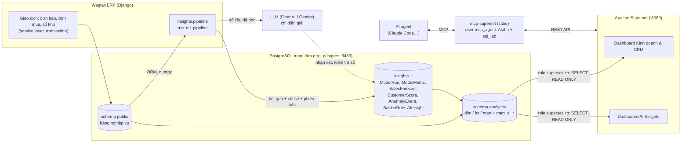

# Báo cáo kỹ thuật TH2 — Phân tích dữ liệu thông minh với AI và Apache Superset (MCP)

Module phân tích bổ sung vào Mini ERP (Wagtail CMS): huấn luyện các mô hình AI/ML trên dữ liệu giao dịch,
lưu kết quả có phiên bản vào PostgreSQL, trực quan hóa trên Apache Superset, và cho AI agent điều khiển Superset
qua **Superset MCP server** (`mcp-superset` trên PyPI).

> Toàn bộ số liệu trong mục 6 là kết quả chạy thật của `python manage.py run_ml_pipeline` trên dữ liệu mô phỏng
> 2 năm của dự án; không có số nào được điền tay. **Dữ liệu là mô phỏng** nên các chỉ số đo độ khớp của mô hình
> với bộ mô phỏng, không chứng minh hiệu quả trên dữ liệu doanh nghiệp thật (xem mục 8).

## 1. Mục tiêu và đối chiếu checklist

| Checklist TH2 | Đáp ứng bởi | Mục |
|---|---|---|
| 1. Kiến trúc kết nối dữ liệu ERP ↔ CSDL trung tâm | PostgreSQL trung tâm; bảng nghiệp vụ (`public`) → bảng kết quả AI (`insights_*`) → schema `analytics` (view chỉ-đọc) → Superset | 2 |
| 2. Triển khai mô hình AI phân tích dữ liệu | 5 bài toán, 11 thuật toán: dự báo doanh thu, phân khúc khách hàng, dự báo rời bỏ, phát hiện bất thường, phân tích giỏ hàng; LLM viết nhận xét | 4 |
| 3. Cấu hình Superset MCP, kết nối nguồn dữ liệu, xây biểu đồ | `mcp-superset` 0.3.1 (137 công cụ), tài khoản quyền hạn chế, `.mcp.json`, script kiểm tra | 5 |
| 4. Đưa kết quả AI vào dashboard Superset | Dashboard "Mini ERP · AI Insights" 16 biểu đồ đọc 7 view `mart_ai_*` | 3 |
| 5. Báo cáo kỹ thuật, luồng dữ liệu, đánh giá hiệu quả mô hình | Tài liệu này | 2, 6 |
| 6. Nhiều mô hình / phương pháp (sáng tạo) | So sánh nhiều thuật toán mỗi bài toán + mốc so sánh; LLM diễn giải có kiểm tra số liệu; MCP cho agent | 4, 7 |

## 2. Kiến trúc và luồng dữ liệu



**Các bước của một lần chạy** (`python manage.py run_ml_pipeline`, chạy tay hoặc đặt lịch bằng cron / Task Scheduler;
`run_scheduler` hiện chưa gọi lệnh này):

1. Đọc dữ liệu đơn đã giao đến ngày `as_of` (Chủ nhật gần nhất trước hôm nay 2 ngày, để tuần dự báo khớp tuần ISO
   và không dính các đơn chưa giao xong) bằng ORM, chuyển thành mảng numpy. Ngày tính theo giờ Việt Nam,
   giống view analytics.
2. Mỗi bài toán chạy trong **một transaction riêng** và tạo một `ModelRun` (thuật toán champion, tham số, tóm tắt,
   thời gian chạy). Lỗi ở một bài toán được ghi lại (`status=failed`) và không làm dừng bài khác.
3. Xong thì `ModelRun` mới thành `is_current`; bản cũ vẫn giữ để theo dõi chất lượng theo thời gian.
4. View `analytics.mart_ai_*` chỉ lộ lần chạy hiện hành. Superset đọc bằng role chỉ-đọc `superset_ro`.
5. `python manage.py verify_analytics` đối chiếu số trong view với ORM (gồm 7 phép kiểm tra cho phần AI).

### Mô hình dữ liệu kết quả

| Bảng | Một dòng là | View Superset |
|---|---|---|
| `insights_modelrun` | một lần chạy một bài toán (phiên bản, tham số, tóm tắt) | `mart_ai_model_runs` |
| `insights_modelmetric` | một chỉ số của một thuật toán / phạm vi (WAPE, AUC, F1…) | `mart_ai_model_metrics` |
| `insights_salesforecast` | doanh thu một ngày × phạm vi × thuật toán: backtest (có `actual`) hoặc tương lai | `mart_ai_forecast` |
| `insights_customerscore` | một khách hàng: phân khúc K-Means, phân khúc theo luật, xác suất rời bỏ, mức rủi ro, yếu tố chính | `mart_ai_customer_score` |
| `insights_anomalyevent` | một ngày bất thường của một kho theo một thuật toán | `mart_ai_anomaly` |
| `insights_basketrule` | một luật mua kèm A → B | `mart_ai_basket_rules` |
| `insights_aiinsight` | một nhận xét bằng ngôn ngữ tự nhiên, kèm cảnh báo kiểm tra số | `mart_ai_insight` |

## 3. Dashboard "Mini ERP · AI Insights"

Tạo bằng `python manage.py provision_superset` (định nghĩa trong `analytics/ai_dashboard_spec.py`), 16 biểu đồ:

| Hàng | Biểu đồ |
|---|---|
| 1 | KPI: WAPE tuần của mô hình dự báo tốt nhất · AUC dự báo rời bỏ · số khách nguy cơ cao · doanh số 365 ngày có nguy cơ |
| 2 | Doanh thu thực tế và dự báo theo tuần (có cận P10/P90) · so sánh WAPE các thuật toán dự báo |
| 3 | Mức rủi ro rời bỏ · danh sách khách nguy cơ cao cần chăm sóc (kèm "yếu tố chính") · so sánh AUC các mô hình |
| 4 | Phân khúc K-Means · đặc điểm trung bình từng phân khúc |
| 5 | Ngày doanh thu bất thường · precision / recall / F1 của 2 bộ phát hiện |
| 6 | Cặp sản phẩm hay mua kèm (lift) · nhận xét do AI viết |
| 7 | Lịch sử các lần chạy mô hình |


## 4. Mô hình AI / ML

Thư viện: **scikit-learn** (mô hình) và **numpy**; Holt-Winters tự viết bằng numpy để không thêm phụ thuộc.

### 4.1 Dự báo doanh thu (`insights/forecasting.py`)

Chuỗi doanh thu theo ngày cho 10 phạm vi: toàn công ty, 3 kho, 6 danh mục. Dự báo 28 ngày tới.

| Thuật toán | Mô tả |
|---|---|
| `seasonal_naive` | **Mốc so sánh**: lặp lại tuần gần nhất |
| `holt_winters` | Làm mượt mũ cộng tính, mùa vụ tuần, xu hướng tắt dần (φ = 0,9); α, β, γ chọn bằng lưới 27 tổ hợp theo sai số một bước |
| `gbm` | `HistGradientBoostingRegressor` trên đặc trưng lịch, độ trễ 28/35/42/56/91/**364** ngày, trung bình trượt; chỉ dùng độ trễ ≥ 28 ngày nên dự báo trực tiếp được cả 28 ngày, không lan truyền sai số |

- **Đánh giá:** backtest cuốn chiếu 3 lần × 28 ngày (12 tuần cuối), mỗi lần huấn luyện chỉ trên dữ liệu trước mốc.
- **Chỉ số:** WAPE theo ngày, theo tuần, MAPE, RMSE, độ lệch (bias), mức cải thiện so với mốc (`skill_vs_naive_pct`).
- **Chọn champion** cho từng phạm vi theo WAPE tuần.
- **Khoảng dự báo** P10–P90 lấy từ phân vị sai số backtest (không giả định phân phối chuẩn).

### 4.2 Phân khúc khách hàng (`insights/segmentation.py`)

- Đặc trưng RFM trong 365 ngày (số ngày từ lần mua cuối, số đơn, doanh số) → log1p → chuẩn hóa → **K-Means**.
- Số nhóm k ∈ {3..6} chọn theo **silhouette**.
- Tên nhóm theo thứ hạng điểm tổng hợp z(M) + z(F) − z(R) của tâm cụm.
- So với phân khúc theo **luật RFM ngũ phân vị** bằng chỉ số Adjusted Rand (ARI) để thấy ML khác luật ở đâu.

### 4.3 Dự báo rời bỏ (`insights/churn.py`)

- **Bài toán:** khách đang hoạt động (có đơn trong 180 ngày) có **không mua gì trong 60 ngày tới** hay không.
- **10 đặc trưng** tại mỗi mốc: recency, số đơn 30/60/90/180 ngày, doanh số 90/180 ngày, khoảng cách TB giữa
  các đơn, xu hướng tần suất (60 ngày gần so với 60 ngày trước đó), thâm niên.
- **Chia tập theo thời gian, không xáo trộn:** tập kiểm tra tại mốc `as_of − 60`; tập huấn luyện gồm nhiều mốc cách
  nhau 30 ngày, mốc cuối là `as_of − 120`, nên nhãn của tập huấn luyện kết thúc trước mốc kiểm tra (không rò rỉ).
- **Mô hình:** luật `recency_rule` (mốc so sánh), Logistic Regression, `HistGradientBoostingClassifier`.
- **Chỉ số:** ROC-AUC, PR-AUC, precision trong 20% khách điểm cao nhất, Brier score; mức quan trọng đặc trưng theo
  hoán vị (permutation importance) trên tập kiểm tra.
- **Chấm điểm:** champion huấn luyện lại trên mọi nhãn đã biết, chấm điểm khách đang hoạt động tại `as_of`.
  Mức rủi ro **theo thứ hạng** trong nhóm khách đang hoạt động: 20% điểm cao nhất là "Cao" (chất lượng danh sách
  này chính là `precision_top20` đo trên tập kiểm tra), 30% kế tiếp là "Trung bình". Không dùng ngưỡng xác suất
  cố định: ở dữ liệu thật của dự án, xác suất lớn nhất chỉ khoảng 0,58, nên ngưỡng 0,6 cho ra danh sách rỗng. Cột "yếu tố chính" lấy từ đóng góp lớn nhất trong mô hình logistic
  (dễ giải thích cho nhân viên bán hàng).

### 4.4 Phát hiện bất thường (`insights/anomaly.py`)

| Thuật toán | Mô tả |
|---|---|
| `robust_z` | Kỳ vọng = trung vị cùng thứ 8 tuần trước; thang đo = MAD của sai số 56 ngày trước; cờ khi \|z\| ≥ 3,5 |
| `isolation_forest` | Isolation Forest trên log doanh thu, tỉ lệ so với kỳ vọng, chênh so với 7 ngày trước; ~5% ngày bất thường nhất |

Dữ liệu thật không có nhãn bất thường, nên đánh giá bằng cách **chèn bất thường giả** (tăng ×2–3,5 hoặc tụt còn
10–40%) vào 6% số ngày trong 180 ngày cuối, lặp 5 lần × 3 kho, rồi đo precision / recall / F1. Ngày biến động tự
nhiên cũng bị tính là dương tính giả, nên precision đo được là **cận dưới thận trọng**.

### 4.5 Phân tích giỏ hàng (`insights/basket.py`)

Luật kết hợp cặp A → B trên các đơn đã giao: support, confidence, **lift**; giữ cặp ≥ 30 đơn và lift ≥ 1,2.
Bộ mô phỏng có cài sẵn 8 cặp hay mua cùng nhau, nên kiểm chứng được mô hình có tìm lại đúng các cặp đó không
(`seeded_pairs_recovered`).

### 4.6 Nhận xét bằng ngôn ngữ tự nhiên (`insights/narrative.py`)

LLM (OpenAI hoặc Gemini, qua `ai.client`) nhận **kết quả đã tính** của 5 bài toán dưới dạng JSON và viết 4–6 nhận
xét theo JSON schema cố định. Mọi con số trong văn bản AI được đối chiếu lại với dữ liệu đầu vào
(`reports.services.check_numbers`); số không khớp thì ghi cảnh báo, hiện ở cột `warning_count` trên dashboard.
Không có API key hoặc AI lỗi thì dùng mẫu câu cố định. Mỗi lần gọi ghi vào `AICallLog` (token, độ trễ, lỗi).

## 5. Superset MCP

[`mcp-superset`](https://pypi.org/project/mcp-superset/) là MCP server cộng đồng cho Apache Superset (137 công cụ:
dashboard, chart, dataset, database, SQL Lab, security…). Nó cho phép AI agent đọc dữ liệu và tạo biểu đồ
bằng ngôn ngữ tự nhiên, ví dụ "tạo biểu đồ cột doanh thu theo kho từ dataset mart_daily_sales".

### Cấu hình

```bash
pip install -r requirements-dev.txt                # gồm mcp-superset (cần Python >= 3.12)

# 1. Tạo tài khoản Superset riêng cho MCP (chạy trong container, idempotent)
copy .env.mcp.example .env.mcp                     # đặt SUPERSET_PASSWORD
docker exec -e MCP_USERNAME=mcp_agent -e MCP_PASSWORD=<mật khẩu trong .env.mcp> \
    erp_superset python /app/create_mcp_user.py
# (Git Bash trên Windows: thêm MSYS_NO_PATHCONV=1 trước lệnh docker)

# 2. Kiểm tra kết nối và các chốt an toàn
python scripts/mcp_smoke_test.py                   # chỉ đọc
python scripts/mcp_smoke_test.py --write           # thêm: tạo 1 biểu đồ thử, đọc dữ liệu, xóa
```

Claude Code đọc cấu hình cấp dự án trong `.mcp.json` (không chứa mật khẩu; mật khẩu nằm trong `.env.mcp`,
đã gitignore):

```json
{
  "mcpServers": {
    "superset": {
      "command": ".venv/Scripts/mcp-superset.exe",
      "args": ["--transport", "stdio", "--env-file", ".env.mcp"]
    }
  }
}
```

Trên macOS/Linux đổi `command` thành `.venv/bin/mcp-superset`.

### Bảo mật

| Lớp | Biện pháp |
|---|---|
| Tài khoản | `mcp_agent` với role **Alpha + sql_lab**, **không phải Admin**: không tạo / sửa được user, role, quyền |
| Dữ liệu | Superset kết nối Postgres bằng `superset_ro`: chỉ `SELECT` trên schema `analytics`, giao dịch READ ONLY, không đọc được `public` (mật khẩu băm, nội dung prompt AI, email thật) |
| SQL Lab | `allow_dml = False` ở kết nối Superset; `mcp-superset` tự chặn DROP / DELETE / UPDATE / INSERT |
| Thao tác xóa | Công cụ xóa của MCP bắt buộc `confirm_delete=True` |
| Bí mật | `.env.mcp` đã gitignore; `.mcp.json` chỉ chứa đường dẫn |
| Mạng | Superset chỉ lắng nghe trên `127.0.0.1`; MCP chạy qua stdio, không mở cổng |

Giới hạn: role Alpha vẫn sửa / xóa được mọi biểu đồ và dashboard. Khi đưa lên môi trường dùng chung, nên tạo role
riêng chỉ có quyền trên các dataset `analytics` và dashboard cần thiết.

## 6. Kết quả và đánh giá

Lần chạy: `as_of` = 2026-10-11, lịch sử 727 ngày, 500 khách hàng, 11.671 đơn đã giao
(`seed_data --days 730 --customers 500`). Tổng thời gian chạy khoảng 38 giây trên laptop:
dự báo 21,6 s · bất thường 9,5 s · nhận xét AI 3,2 s · rời bỏ 2,3 s · giỏ hàng 1,1 s · phân khúc 0,5 s.

### 6.1 Dự báo doanh thu: backtest 3 × 28 ngày

Toàn công ty (`TOTAL`):

| Thuật toán | WAPE tuần | WAPE ngày | MAPE ngày | RMSE ngày (VNĐ) | Độ lệch | Cải thiện so với mốc |
|---|---|---|---|---|---|---|
| seasonal_naive (mốc) | 6,6% | 10,5% | 10,6% | 6,09 triệu | +0,4% | 0% |
| holt_winters | 5,5% | 8,7% | 8,9% | 5,39 triệu | −0,1% | 16,1% |
| **gbm** (champion) | **4,2%** | **7,4%** | **7,4%** | **4,53 triệu** | −2,0% | **36,3%** |

WAPE tuần theo phạm vi (in đậm là champion):

| Phạm vi | seasonal_naive | holt_winters | gbm |
|---|---|---|---|
| Kho HN | 6,7% | **5,7%** | 6,0% |
| Kho HCM | 7,9% | 7,9% | **5,5%** |
| Kho DN | 6,2% | **5,8%** | 5,8% |
| Đồ uống | 9,0% | 8,5% | **6,2%** |
| Bánh kẹo | 23,2% | 20,4% | **9,4%** |
| Thực phẩm khô | 5,8% | 6,3% | **5,6%** |
| Hóa mỹ phẩm | **4,3%** | 4,6% | 5,4% |
| Gia dụng | **10,0%** | 10,2% | 10,7% |
| Văn phòng phẩm | 15,5% | 14,4% | **7,5%** |

Nhận xét:
- GBM thắng 6/10 phạm vi. Lợi thế lớn nhất ở các danh mục có mùa vụ năm rõ (bánh kẹo dịp Tết / Trung thu,
  văn phòng phẩm mùa tựu trường), nhờ độ trễ 364 ngày.
- Ở 4 phạm vi còn lại, mô hình đơn giản hơn thắng hoặc ngang. Vì vậy hệ thống **chọn champion riêng cho từng
  phạm vi** thay vì áp một mô hình cho tất cả.
- Khoảng P10–P90 phủ 78,6% số ngày backtest. Đây là độ phủ **trong mẫu**: phân vị được tính từ chính các sai số
  này, nên con số gần 80% là do cách dựng, không phải đánh giá độc lập. Đó cũng là lý do 3 thuật toán có cùng
  độ phủ.
- Dự báo 28 ngày tới (12/10 – 08/11/2026): **1,23 tỷ đồng**, giảm 4,3% so với 28 ngày trước (1,29 tỷ đồng).

### 6.2 Phân khúc khách hàng

K-Means chọn **k = 3** (silhouette 0,52, cao nhất trong k = 3..6) trên 492 khách có đơn:

| Phân khúc | Số khách | Ngày từ lần mua cuối (TB) | Số đơn / 365 ngày (TB) | Doanh số 365 ngày (TB) |
|---|---|---|---|---|
| Giá trị cao | 156 | 8,4 | 30,9 | 75,7 triệu |
| Phổ thông | 263 | 109,3 | 5,7 | 14,5 triệu |
| Đã ngừng mua | 73 | 509,5 | 0 | 0 |

So với phân khúc theo luật RFM: ARI = 0,421, tức khớp một phần.
- 118/156 khách "Giá trị cao" là "VIP" theo luật.
- Nhóm "Phổ thông" gộp nhiều nhóm luật, trong đó có 24 khách luật gọi là "Nguy cơ rời bỏ (giá trị cao)". Đây là
  nhóm nên xem thêm điểm rời bỏ ở mục 6.3, vì K-Means chỉ nhìn 3 chiều RFM.

### 6.3 Dự báo rời bỏ (60 ngày)

Tập huấn luyện 6.342 dòng (nhiều mốc thời gian, tỉ lệ rời bỏ 36,8%); tập kiểm tra 371 khách tại mốc
2026-08-12 (tỉ lệ rời bỏ 30,5%).

| Mô hình | ROC-AUC | PR-AUC | Precision top 20% | Brier |
|---|---|---|---|---|
| recency_rule (mốc) | 0,615 | 0,404 | **0,459** | – |
| **logistic** (champion) | **0,661** | **0,412** | 0,432 | **0,197** |
| gbm | 0,653 | 0,410 | 0,405 | 0,203 |

Đánh giá thẳng thắn:
- Mô hình học máy chỉ **hơn luật đơn giản một chút** về AUC (+0,046).
- Ở top 20%, luật recency lại chính xác hơn (0,459 so với 0,432). Trên 74 khách, chênh lệch này chỉ khoảng 2 khách,
  nằm trong sai số ngẫu nhiên của tập kiểm tra 371 khách.
- Cả hai đều tốt hơn chọn ngẫu nhiên (30,5%) khoảng 1,4–1,5 lần.
- Giải thích khả dĩ: khách "Phổ thông" mua trung bình 5,7 đơn/năm, tức cách nhau khoảng 64 ngày, dài hơn cửa sổ nhãn
  60 ngày. Nhiều khách không mua trong 60 ngày dù không rời bỏ, nên nhãn bị nhiễu.
- Các đặc trưng quan trọng nhất (giảm AUC khi xáo trộn): số đơn 180 ngày (0,024), số đơn 60 ngày (0,023),
  số đơn 90 ngày (0,011), recency (0,010).

Kết quả chấm điểm 492 khách tại 2026-10-11:

| Mức rủi ro | Số khách | Doanh số 365 ngày |
|---|---|---|
| Cao (top 20%) | 74 | 1,07 tỷ |
| Trung bình (30% kế tiếp) | 111 | 1,58 tỷ |
| Thấp | 185 | 12,62 tỷ |
| Đã rời bỏ (> 180 ngày không mua) | 122 | 0,35 tỷ |

### 6.4 Phát hiện bất thường

Đánh giá bằng chèn bất thường giả (180 ngày cuối × 3 kho × 5 lần lặp):

| Thuật toán | Precision | Recall | F1 |
|---|---|---|---|
| **robust_z** (champion) | **0,928** | 0,847 | **0,882** |
| isolation_forest | 0,542 | **0,987** | 0,699 |

- Isolation Forest bắt gần hết nhưng báo nhầm nhiều. Lý do: nó luôn gắn cờ khoảng 5% số ngày, bất kể có bất thường
  thật hay không.
- Trên dữ liệu thật trong 180 ngày cuối: robust_z gắn cờ 3 ngày, isolation_forest 19 ngày.
- 3 ngày của robust_z đều là ngày doanh thu sụt:
  - kho DN ngày 02/09/2026: −100%. Kho này không có đơn nào trong ngày, trong khi HN và HCM vẫn bán bình thường;
    kho DN nhỏ (vài đơn/ngày) nên một ngày bằng 0 có thể chỉ do ngẫu nhiên;
  - kho DN ngày 26/06/2026: −57,2%;
  - kho HN ngày 09/10/2026: −40,0%.

### 6.5 Phân tích giỏ hàng

- 40 luật từ 11.671 đơn.
- **8/8 cặp sản phẩm cài sẵn trong bộ mô phỏng được tìm lại** (`seeded_pairs_recovered` = 1,0) và nằm ở đầu bảng,
  lift 3,7–4,2. Cụ thể, 16 luật đầu (8 cặp × 2 chiều) đều là cặp cài sẵn; luật kế tiếp chỉ có lift 1,78. Ví dụ:
  - Nồi cơm điện → Gạo 5 kg: confidence 60,2%, lift 4,18;
  - Dầu gội ↔ Sữa tắm: lift 4,09;
  - Nước khoáng → Mì tôm: lift 4,08.
- Luật có hướng: Gạo → Nồi cơm chỉ có confidence 28,8%. Nghĩa là nên gợi ý gạo cho người mua nồi cơm, không phải
  ngược lại.

### 6.6 Nhận xét AI và kiểm tra số

Gemini (`gemini-flash-lite-latest`) viết 5 nhận xét cho dự báo, khách hàng, bất thường, giỏ hàng và chất lượng mô
hình. Lần chạy cuối có 0 cảnh báo số liệu.

Các lần chạy trước đã giúp phát hiện và sửa 4 lỗi:

| Lỗi | Trước khi sửa | Đã sửa |
|---|---|---|
| Đếm sự kiện bất thường | "22 sự kiện" là tổng của cả 2 thuật toán, AI ghi là của Robust Z | Tóm tắt tách số theo thuật toán |
| Chạy `--only insight` | AI nhận dữ liệu rỗng và viết "chưa có dữ liệu" | Lấy kết quả hiện hành trong CSDL; không có kết quả thì báo lỗi |
| Đọc số "0,882" | Hiểu thành 882 | Bộ đọc số coi "0,882" là số thập phân |
| Cảnh báo "100%" | Báo sai vì KPI là −100 | So với giá trị tuyệt đối của KPI |

### 6.7 Kiểm tra tích hợp

| Kiểm tra | Kết quả |
|---|---|
| `verify_analytics`: view Superset so với ORM (11 nghiệp vụ + 7 AI) | 18/18 khớp |
| `scripts/mcp_smoke_test.py --write`: kết nối, quyền, chặn DML, tạo / đọc / xóa biểu đồ qua MCP | 12/12 đạt |
| `pytest` trên PostgreSQL: 136 test, trong đó 29 test cho mô hình và pipeline AI | đạt |

## 7. Các hướng ứng dụng AI khác (đề xuất mở rộng)

| Hướng | Cách làm | Giá trị |
|---|---|---|
| Dự báo phân cấp (hierarchical reconciliation) | Đảm bảo tổng dự báo các kho = dự báo toàn công ty (MinT / bottom-up) | Số liệu kế hoạch nhất quán giữa các cấp |
| Dự báo theo xác suất | Quantile regression (`HistGradientBoostingRegressor(loss="quantile")`) thay khoảng thực nghiệm | Khoảng tin cậy theo từng ngày, phục vụ tồn an toàn |
| Gợi ý bán kèm cá nhân hóa | Lọc cộng tác trên ma trận khách × sản phẩm | Đề xuất cho từng khách thay vì luật chung |
| Định giá / khuyến mãi | Ước lượng độ co giãn giá theo danh mục | Tối ưu biên lợi nhuận |
| Phân loại văn bản | LLM phân loại ghi chú đơn hàng, phản hồi khách | Nguồn tín hiệu rời bỏ bổ sung |
| Agent phân tích qua MCP | Agent đọc `mart_ai_*` qua MCP, tự tạo biểu đồ và viết tóm tắt tuần | Báo cáo theo yêu cầu bằng ngôn ngữ tự nhiên |
| Giám sát trôi mô hình | So chỉ số `ModelMetric` giữa các lần chạy, cảnh báo khi WAPE / AUC xấu đi | Biết khi nào cần huấn luyện lại |

## 8. Hạn chế

- **Dữ liệu mô phỏng.** Mùa vụ, khách rời bỏ (30% khách, giảm dần 60 ngày rồi dừng) và cặp mua kèm đều do bộ mô
  phỏng cài sẵn. Mô hình tìm lại được các quy luật này chứng tỏ pipeline đúng, chưa chứng minh hiệu quả thực tế.
- **Lịch sử 2 năm** chỉ cho một chu kỳ cùng kỳ năm trước; mùa vụ năm ước lượng còn thô.
- **Khoảng P10–P90** tính trên chính sai số backtest nên độ phủ đo được (78,6%) là lạc quan.
- **Dự báo rời bỏ chỉ hơn luật recency một chút** (AUC 0,66 so với 0,615) và tập kiểm tra nhỏ (371 khách). Nên
  dùng làm danh sách ưu tiên chăm sóc, không dùng như xác suất chính xác. Hướng cải thiện: cửa sổ nhãn theo nhịp
  mua của từng khách (vd. gấp 2 lần khoảng cách trung bình), thêm đặc trưng danh mục, kênh, khiếu nại.
- **Precision của phát hiện bất thường** là cận dưới vì ngày biến động tự nhiên bị tính là dương tính giả.
- **"Yếu tố chính"** lấy từ mô hình tuyến tính, có thể khác mô hình champion nếu champion là GBM.
- Superset MCP là gói **cộng đồng** (không phải bản chính thức của Apache), đã kiểm thử với Superset 4.1.1.
