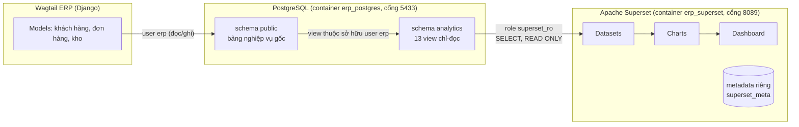

# Tích hợp Wagtail ERP với Apache Superset

Tài liệu này mô tả cách nối dữ liệu từ hệ thống Wagtail ERP sang Apache Superset
để dựng dashboard phân tích kinh doanh và CRM.

## 1. Kiến trúc



Điểm then chốt: **Superset không kết nối bằng tài khoản của ứng dụng và không
đọc thẳng bảng nghiệp vụ.** Nó chỉ nhìn thấy schema `analytics` gồm các view đã
chọn lọc sẵn cột.

## 2. Mô hình bảo mật

| Lớp | Biện pháp |
|---|---|
| Tài khoản CSDL | Role riêng `superset_ro`: `NOSUPERUSER NOCREATEDB NOCREATEROLE`, `default_transaction_read_only = on`, `statement_timeout = 120s` |
| Phạm vi dữ liệu | Bị `REVOKE ALL` trên schema `public`; chỉ có `USAGE` + `SELECT` trên schema `analytics` |
| Dữ liệu cá nhân | View `dim_customer` che email (`k***@example.com`) và điện thoại (`***567`); không view nào để lộ cột `password`, `email`, `phone`, `session_data` |
| Dữ liệu AI | `mart_ai_usage` chỉ có số liệu tổng hợp (token, độ trễ, tỉ lệ thành công); **không** có `request_excerpt` / `response_excerpt` là nội dung đã gửi cho nhà cung cấp AI |
| Ứng dụng Superset | `allow_dml = false`, `allow_ctas = false`, `PREVENT_UNSAFE_DB_CONNECTIONS = True`, không cho đăng ký tài khoản, không có vai trò công khai |
| Mạng | Cả Postgres (5433) và Superset (8089) chỉ lắng nghe trên `127.0.0.1` |
| Bí mật | Mật khẩu và `SUPERSET_SECRET_KEY` nằm trong `.env` (đã gitignore), không nằm trong file cấu hình |

Kiểm chứng nhanh bằng chính role của Superset:

```sql
-- Được phép
SELECT count(*) FROM analytics.mart_daily_sales;

-- Bị từ chối: permission denied for table auth_user
SELECT * FROM public.auth_user;
-- Bị từ chối: permission denied for table ai_aicalllog
SELECT * FROM public.ai_aicalllog;
-- Bị từ chối: cannot execute CREATE TABLE in a read-only transaction
CREATE TABLE analytics.hack (id int);
```

## 3. Cài đặt

### 3.1 Khởi động stack

```bash
# 1. Sinh bí mật (chạy một lần) rồi điền vào .env
python -c "import secrets; print('SUPERSET_SECRET_KEY=' + secrets.token_urlsafe(42))"
python -c "import secrets; print('SUPERSET_DB_PASSWORD=' + secrets.token_urlsafe(18))"
python -c "import secrets; print('SUPERSET_ADMIN_PASSWORD=' + secrets.token_urlsafe(12))"
python -c "import secrets; print('POSTGRES_PASSWORD=' + secrets.token_urlsafe(18))"

# 2. Bật PostgreSQL + Superset
docker compose -f docker-compose.analytics.yml up -d --build
```

Cần có trong `.env`:

```ini
DATABASE_URL=postgres://erp:<POSTGRES_PASSWORD>@127.0.0.1:5433/erp
POSTGRES_DB=erp
POSTGRES_USER=erp
POSTGRES_PASSWORD=...
SUPERSET_DB_USER=superset_ro
SUPERSET_DB_PASSWORD=...
SUPERSET_META_PASSWORD=...
SUPERSET_SECRET_KEY=...
SUPERSET_ADMIN_USER=admin
SUPERSET_ADMIN_PASSWORD=...
SUPERSET_URL=http://127.0.0.1:8089
```

> Cổng 5433 và 8089 được chọn để không đụng Postgres (5432) hoặc Superset (8088)
> mặc định có thể đang chạy sẵn trên máy.
>
> Trong `DATABASE_URL` phải dùng **`127.0.0.1`**, không dùng `localhost`: trên Windows
> `localhost` phân giải ra `::1` trước, mà Docker chỉ mở cổng trên IPv4, nên mỗi kết nối
> mới phải chờ hết timeout TCP — đo được khoảng 130 giây cho kết nối đầu tiên của mỗi
> tiến trình Django.

### 3.2 Đưa dữ liệu vào PostgreSQL

Chọn một trong hai cách:

```bash
# A. Chuyển dữ liệu đang có từ SQLite sang (giữ nguyên lịch sử, log AI…)
python manage.py migrate
python manage.py copy_sqlite_to_postgres
python manage.py update_index      # dựng lại chỉ mục tìm kiếm của Wagtail

# B. Hoặc tạo dữ liệu mẫu mới trực tiếp trên PostgreSQL
python manage.py setup_demo
```

### 3.3 Tạo lớp analytics và cấp quyền

```bash
python manage.py create_analytics_views
```

Lệnh này tạo schema `analytics` với 13 view nghiệp vụ và 7 view kết quả AI
(`mart_ai_*`, xem [AI_ANALYTICS.md](AI_ANALYTICS.md)), tạo role `superset_ro`
(nếu chưa có) và cấp đúng quyền chỉ-đọc như mục 2.

### 3.4 Tạo dataset, biểu đồ và dashboard

```bash
python manage.py provision_superset
```

Lệnh gọi REST API của Superset để tạo (hoặc cập nhật nếu đã có):

* 1 kết nối CSDL — SQLAlchemy URI dùng role chỉ-đọc;
* 20 dataset ứng với 20 view;
* 29 biểu đồ;
* 2 dashboard: `Mini ERP · Kinh doanh & CRM` (13 biểu đồ) và `Mini ERP · AI Insights`
  (16 biểu đồ, cần chạy `python manage.py run_ml_pipeline` trước để có dữ liệu).

Mở <http://127.0.0.1:8089/superset/dashboard/mini-erp-crm/> và đăng nhập bằng
`SUPERSET_ADMIN_USER` / `SUPERSET_ADMIN_PASSWORD`.

### 3.5 Kiểm tra số liệu

```bash
python manage.py verify_analytics
```

Lệnh đối chiếu 11 chỉ số giữa view SQL (Superset đọc) và `reports/kpis.py`
(ERP tính bằng Django ORM): doanh thu, giá vốn, lợi nhuận gộp, số đơn đã giao,
giá trị tồn kho, số vị trí hết hàng, số khách hàng, doanh thu trọn đời…
Khi đã có kết quả AI, lệnh kiểm tra thêm 7 chỉ số của các view `mart_ai_*`.
Lệch quá 0,01 là trả về mã lỗi khác 0, nên có thể đưa vào CI.

## 4. Lớp dữ liệu analytics

SQL nguồn: [`analytics/sql/analytics_views.sql`](../analytics/sql/analytics_views.sql)

### Bảng chiều (dimension)

| View | Nội dung |
|---|---|
| `dim_customer` | Khách hàng, email/điện thoại đã che |
| `dim_product` | Sản phẩm, danh mục, NCC mặc định, biên lợi nhuận niêm yết |
| `dim_warehouse` | Kho |
| `dim_supplier` | Nhà cung cấp, lead time cam kết, đánh giá |

### Bảng sự kiện (fact)

| View | Hạt dữ liệu |
|---|---|
| `fct_sales_line` | Một dòng hàng trên đơn bán (lọc `status = 'SHIPPED'` để lấy doanh thu đã thực hiện) |
| `fct_purchase_line` | Một dòng hàng trên đơn mua, kèm `delay_days` và `is_late` |
| `fct_stock_movement` | Một bút toán sổ kho |

### Bảng tổng hợp (mart)

| View | Dùng cho |
|---|---|
| `mart_daily_sales` | Doanh thu / giá vốn / lợi nhuận gộp theo ngày × kho |
| `mart_customer_rfm` | **CRM**: phân khúc khách hàng theo RFM |
| `mart_inventory_status` | Tồn kho so với điểm đặt hàng lại |
| `mart_supplier_performance` | Tỷ lệ và số ngày giao trễ theo NCC |
| `mart_reorder_suggestion` | Đề xuất nhập hàng: số hệ thống so với khuyến nghị AI |
| `mart_ai_usage` | Token và độ trễ của các lần gọi AI |

### Quy ước tính toán

* **Múi giờ**: Django lưu `timestamptz`; mọi view quy đổi về ngày địa phương
  bằng `AT TIME ZONE 'Asia/Ho_Chi_Minh'` để khớp với báo cáo của ERP.
* **Doanh thu** = `quantity × unit_price` của các dòng thuộc đơn `SHIPPED`,
  tính theo ngày giao hàng.
* **Giá vốn** lấy từ phiếu xuất kho (`movement_type = 'OUT'`), đúng công thức
  `reports/kpis.py:sales_summary()`. Cột `standard_cogs` trong `fct_sales_line`
  dùng giá nhập niêm yết, chỉ để so sánh tương đối giữa các sản phẩm.
* **ROP hiệu lực**: ưu tiên ROP theo kho do `run_forecast` tính; nếu trống thì
  lấy ROP của sản phẩm — giống thuộc tính `effective_reorder_point` trong Django.

### Phân khúc RFM

`R` = số ngày kể từ lần mua gần nhất, `F` = số đơn đã giao, `M` = tổng doanh thu.
Mỗi chỉ số được chấm 1–5 theo ngũ phân vị (`ntile(5)`) trên tập khách có phát sinh mua.

| Phân khúc | Điều kiện |
|---|---|
| VIP | R ≥ 4 và F ≥ 4 và M ≥ 4 |
| Trung thành | F ≥ 4 và R ≥ 3 |
| Khách mới / tiềm năng | R ≥ 4 và F ≤ 2 |
| Nguy cơ rời bỏ (giá trị cao) | R ≤ 2 và M ≥ 4 |
| Đã ngừng mua | R = 1 |
| Thông thường | còn lại |

## 5. Dashboard

`Mini ERP · Kinh doanh & CRM` — 13 biểu đồ, định nghĩa trong
[`analytics/dashboard_spec.py`](../analytics/dashboard_spec.py):

| Hàng | Biểu đồ |
|---|---|
| 1 | 4 thẻ KPI: doanh thu, lợi nhuận gộp, số đơn đã giao, giá trị tồn kho |
| 2 | Doanh thu theo tháng (cột kép) · Doanh thu theo kho (vành khuyên) |
| 3 | **CRM**: phân khúc RFM (tròn) · giá trị theo phân khúc (cột ngang) · top 10 khách hàng (bảng) |
| 4 | Doanh thu theo danh mục · Tồn kho cần chú ý (bảng) |
| 5 | Tỷ lệ giao trễ theo NCC · Đề xuất nhập hàng: hệ thống so với AI |

Số tiền hiển thị theo **tỷ đồng** (`SUM(x) / 1e9`) vì giá trị VNĐ nguyên bị cắt
chữ số trên thẻ KPI và chồng nhãn trên trục.

Muốn thêm biểu đồ: thêm một mục vào `CHARTS`, thêm tên vào `ROWS`, chạy lại
`python manage.py provision_superset`.

## 6. Vận hành

```bash
# Xem trạng thái
docker compose -f docker-compose.analytics.yml ps

# Nhật ký Superset
docker compose -f docker-compose.analytics.yml logs -f superset

# Dừng (giữ dữ liệu)
docker compose -f docker-compose.analytics.yml stop

# Xóa sạch kể cả dữ liệu
docker compose -f docker-compose.analytics.yml down -v
```

Dữ liệu ERP thay đổi thì dashboard tự cập nhật ở lần làm mới sau (view đọc trực
tiếp bảng gốc, không có bước ETL). Bộ nhớ đệm của Superset đặt 300 giây.

Sau khi đổi model Django và chạy `migrate`, nên chạy lại
`python manage.py create_analytics_views` để view bám theo schema mới.

## 7. Giới hạn đã biết

* View đọc trực tiếp bảng giao dịch. Với khối lượng lớn hơn nhiều (hàng chục
  triệu dòng) nên chuyển `mart_*` sang materialized view và làm mới theo lịch.
* Chưa bật Celery nên không dùng được truy vấn bất đồng bộ và báo cáo gửi mail
  của Superset (`ALERT_REPORTS = False`).
* Superset chạy qua HTTP ở local. Khi đưa lên môi trường thật cần đặt sau TLS và
  bật `TALISMAN_ENABLED`, `SESSION_COOKIE_SECURE`.
* Dashboard chưa phân quyền theo hàng (row-level security). Nếu muốn mỗi kho chỉ
  xem số liệu của mình thì thêm RLS filter trong Superset trên cột `warehouse_code`.
